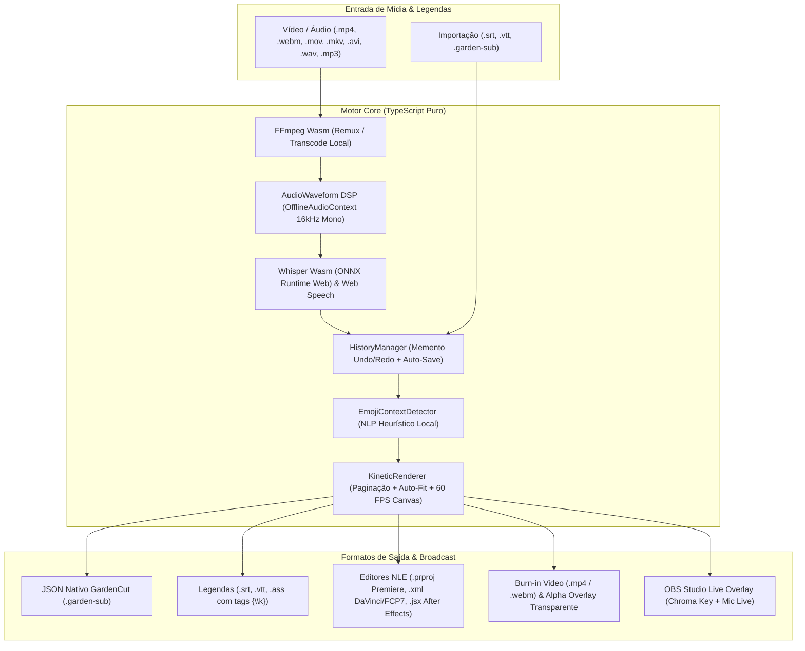

# 🌿 Garden Subtitle

> **Estúdio Web de Legendas Dinâmicas & Cinéticas (Word-by-Word)** com reconhecimento de fala 100% no navegador (*Client-Side AI*), animações estilo Hormozi/MrBeast/Ali Abdaal, Timeline DSP de Ondas de Áudio (16kHz), emojis automáticos, Modo OBS Live e integração nativa com o **GardenCut** e editores NLE profissionais.

---

## 🎯 Por que o Garden Subtitle?

Criadores de conteúdo para **TikTok, Instagram Reels, YouTube Shorts e LinkedIn** dependem de legendas dinâmicas palavra-por-palavra com alto contraste e dinamismo visual para reter a atenção nos primeiros 3 segundos. No entanto:
* Ferramentas populares como CapCut Pro cobram assinaturas recorrentes e restringem a exportação.
* Plataformas online enviam os vídeos dos usuários para servidores externos, violando privacidade e consumindo franquia de upload.

O **Garden Subtitle** executa **100% no navegador**:
1. **Duplo Motor de Transcrição de Voz Local:**
   * **Whisper WebAssembly (16kHz Offline):** Extração acústica PCM Mono 16kHz via `AudioContext` / `OfflineAudioContext` e inferência local via **ONNX Runtime Web (`@huggingface/transformers`)** com perfis de modelo selecionáveis (**Tiny** ~39MB, **Base** ~74MB, **Small** ~244MB), suporte multilíngue (Português, Inglês, Espanhol, Auto) e *Word-Level Timestamps* reais com detecção automática de pausas e pontuação.
   * **Web Speech API (Live):** Reconhecimento em tempo real para vídeos ou captação direta de microfone em transmissões ao vivo.
2. **Timeline Interativa de Áudio (16kHz Waveform DSP) & Edição Cirúrgica:**
   * Visualização das ondas sonoras reais do vídeo com agulha de *playhead* e blocos de legenda redimensionáveis por arraste (*drag handles*).
   * **Editor Word-Level, Split & Merge:** Ajuste individual do texto, tempo inicial (`start`) e final (`end`) de cada palavra, divisão cirúrgica de blocos (`Split` ✂️) e fusão de segmentos (`Merge`), tudo com **Undo/Redo (`Ctrl+Z` / `Ctrl+Y`)** baseado no padrão *Memento* e salvamento automático em `localStorage`.
3. **6 Estilos Cinéticos Icônicos + Customização Completa:**
   * **Hormozi Pop:** Pílula amarela canário (`#fde047`) com zoom dinâmico na palavra ativa.
   * **MrBeast Impact:** Tipografia pesada (`Titan One`), contorno preto espesso e escala dinâmica de `1.28x`.
   * **TikTok Neon Glow:** Sombras neon ciano pulsantes.
   * **Ali Abdaal Highlighter:** Efeito marca-texto fluorescente com rotação estilizada (`-2°`).
   * **Karaoke Wave:** Preenchimento contínuo progressivo palavra por palavra.
   * **Minimal Clean:** Tipografia limpa e sutil para vídeos institucionais.
   * Paginação automática de palavras (`getActiveWordPage`) e auto-ajuste horizontal de fonte para nunca cortar textos nas bordas em `9:16`, `1:1` ou `16:9`.
4. **Inserção Contextual de Emojis:** Algoritmo heurístico que detecta palavras-chave (ex: "dinheiro" ➔ 💰, "ideia" ➔ 💡, "fogo" ➔ 🔥, "foguete" ➔ 🚀) e anima o emoji sincronizado com a voz.
5. **Modo OBS Studio Live Overlay:** Tela dedicada com Chroma Key (Verde, Magenta, Preto ou Transparente) a 60 FPS para legendagem ao vivo em lives.

---

## 🏛️ Arquitetura do Software

---

## 📥 Formatos de Entrada Suportados

* **Nativos Diretos:** `.mp4`, `.webm`, `.mov` (QuickTime iPhone/Mac), `.m4v`, `.ogg`
* **Áudios (Podcasts & Locuções):** `.mp3`, `.wav`, `.m4a`, `.aac`, `.flac`
* **Formatos Estendidos via FFmpeg WebAssembly:** `.mkv` (OBS Studio), `.avi`, `.wmv`, `.flv`, `.mts`, `.ts` (com remuxing automático sem perda ou transcode local direto na máquina do usuário sem envio para a nuvem).
* **Importação Direta de Legendas Existentes:** `.srt`, `.vtt` e `.garden-sub` (com divisão automática palavra por palavra e auto-emoji).

---

## 📦 Formatos de Exportação Suportados

* **Pacote Nativo GardenCut (`.garden-sub`):** Importável diretamente na trilha `track-text` do [GardenCut](https://github.com/FelipeGardenghiDev/garden-cut).
* **Projetos para Editores Profissionais (NLE):**
  * **Adobe Premiere Pro (`.prproj`):** Projeto nativo compactado com Gzip contendo a sequência e os clipes de texto sincronizados.
  * **DaVinci Resolve / Final Cut / Vegas (`.xml`):** Timeline em formato Final Cut Pro 7 XML (`xmeml v4`).
  * **Adobe After Effects (`.jsx`):** Script ExtendScript que gera a composição e camadas de texto animadas com keyframes de escala e cor.
* **Legendas Padrão de Mercado:** `.srt`, WebVTT (`.vtt`) e Advanced SubStation Alpha (`.ass` com cores BGR dinâmicas e tags de karaokê `{\k}` por palavra).
* **Vídeo Final com Legenda Fixa (*Burn-in*) & Alpha Overlay:**
  * Exportação instantânea em `.webm` / `.mp4` nativo via Canvas Stream + MediaRecorder nas proporções `9:16` (`1080x1920`), `1:1` (`1080x1080`) e `16:9` (`1920x1080`).
  * Exportação Universal MP4 (H.264) via motor FFmpeg WebAssembly integrado.
  * **Vídeo de Sobreposição Transparente (Alpha WebM Overlay):** Exportação apenas das legendas animadas sobre canal Alpha 100% transparente.

---

## ⌨️ Atalhos Rápidos

* `Espaço`: Play / Pause no vídeo
* `←` / `→`: Retroceder / Avançar `0.5s` na timeline
* `Ctrl + Z`: Desfazer alteração (*Undo*)
* `Ctrl + Y` ou `Ctrl + Shift + Z`: Refazer alteração (*Redo*)

---

## 🚀 Deploy Web & Aplicativo Android (APK)

* **Web App (GitHub Pages):** [felipegardenghidev.github.io/garden-subtitle](https://felipegardenghidev.github.io/garden-subtitle/)
* **Download do APK Android:** A cada commit na branch principal, o GitHub Actions compila automaticamente o APK nativo através do pipeline Capacitor + Gradle e disponibiliza o artefato `garden-subtitle-debug-apk` para download direto na aba **Actions** do repositório, dispensando o Android Studio na máquina local.

---

## 🛠️ Stack Tecnológica

* **Linguagem:** TypeScript ~6.0
* **Framework:** React 19 + Vite 8
* **Estilização:** Tailwind CSS v4
* **Motor IA & Transcode:** FFmpeg WebAssembly (`@ffmpeg/ffmpeg`) + Whisper WebAssembly (`@huggingface/transformers`)
* **DSP de Áudio:** Web Audio API (`AudioContext`, `OfflineAudioContext` 16kHz PCM)
* **Testes & Qualidade:** Vitest + Oxlint

---

## 🌿 Ecossistema GC Studio

Este projeto integra o ecossistema de aplicações criativas mantidas pelo estúdio **GC Studio** (Felipe Gardenghi).  
Para conhecer outras ferramentas da suíte:
* 🎬 **[GardenCut](https://github.com/FelipeGardenghiDev/garden-cut):** Editor de vídeo não-linear web.
* 🎨 **[Garden Pixel Editor](https://github.com/FelipeGardenghiDev/garden-pixel-editor):** Editor de pixel art e isometria 2:1.
* 🎵 **[VisuChord](https://github.com/FelipeGardenghiDev/visuchord):** Instrumento gestual por IA.
* 🏛️ **[GC Studio Hub](https://github.com/FelipeGardenghiDev/gcstudio):** Central oficial do estúdio.

---

## 📄 Licença
Distribuído sob a licença MIT. Criado por Felipe Gardenghi.
