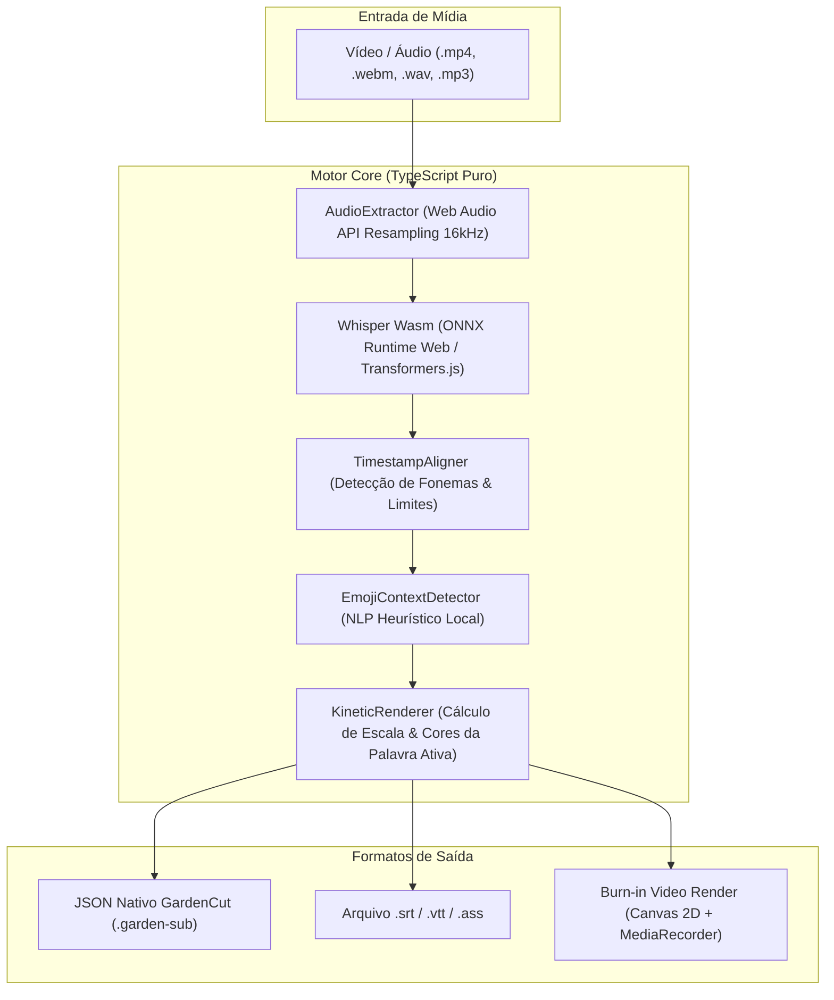

# 🌿 Garden Subtitle

> **Estúdio Web de Legendas Dinâmicas & Cinéticas (Word-by-Word)** com reconhecimento de fala 100% no navegador (*Client-Side AI*), animações estilo Hormozi/MrBeast, emojis automáticos e integração nativa com o **GardenCut**.

---

## 🎯 Por que o Garden Subtitle?

Criadores de conteúdo para **TikTok, Instagram Reels e YouTube Shorts** dependem de legendas dinâmicas palavra-por-palavra com alto contraste e dinamismo visual para reter a atenção nos primeiros 3 segundos. No entanto:
* Ferramentas populares como CapCut Pro cobram assinaturas recorrentes e restringem a exportação.
* Plataformas online enviam os vídeos dos usuários para servidores externos, violando privacidade e consumindo franquia de upload.

O **Garden Subtitle** executa **100% no navegador**:
1. **Transcrição de Voz Local:** Transcrição acústica via **Whisper WebAssembly / ONNX Runtime Web**, processando o áudio na CPU/GPU local sem custos de API ou upload externo.
2. **Timing Cirúrgico (Word-Level Timestamps):** Identificação milimétrica do momento exato em que cada palavra é pronunciada.
3. **Estilos Cinéticos Icônicos:**
   * **Hormozi Pop:** Fundo escuro translúcido com palavras ativas iluminadas em amarelo canário (`#fde047`) ou verde neon.
   * **MrBeast Bold:** Tipografia pesada, contorno preto espesso de 4px e escala dinâmica de 1.15x na palavra ativa.
   * **TikTok Glow:** Sombras coloridas pulsantes e quebras automáticas de 2 a 3 palavras por linha.
4. **Inserção Contextual de Emojis:** Algoritmo que detecta palavras-chave (ex: "dinheiro" ➔ 💰, "ideia" ➔ 💡, "fogo" ➔ 🔥, "foguete" ➔ 🚀) e faz o emoji pular na tela sincronizado com a voz.
5. **Integração com a Suíte Garden Apps:** Exportação direta da trilha de legendas formatadas para a timeline do **GardenCut** em 1 clique.

---

## 🏛️ Arquitetura do Software

---

## 📥 Formatos de Entrada Suportados

* **Nativos Diretos:** `.mp4`, `.webm`, `.mov` (QuickTime iPhone/Mac), `.m4v`, `.ogg`
* **Áudios (Podcasts & Locuções):** `.mp3`, `.wav`, `.m4a`, `.aac`, `.flac`
* **Formatos Estendidos via FFmpeg WebAssembly:** `.mkv` (OBS Studio), `.avi`, `.wmv`, `.flv`, `.mts`, `.ts` (com remuxing automático sem perda ou transcode local direto na máquina do usuário sem envio para a nuvem).
* **Importação Direta de Legendas Existentes:** `.srt`, `.vtt` e `.garden-sub` (com divisão automática palavra por palavra e auto-emoji).

---

## 📦 Formatos de Exportação Suportados

* **Pacote Nativo GardenCut (`.garden-sub`):** Importável diretamente na trilha `track-text` do [GardenCut](https://github.com/FelipeGardenghiDev/garden-cut).
* **Legendas Padrão de Mercado:** `.srt`, WebVTT (`.vtt`) e Advanced SubStation Alpha (`.ass` com estilos e fontes embutidos).
* **Vídeo Final com Legenda Fixa (*Burn-in*):** 
  * Exportação instantânea em `.webm` / `.mp4` nativo via Canvas Stream + MediaRecorder.
  * Exportação Universal MP4 (H.264) via motor FFmpeg WebAssembly integrado.
* **Vídeo de Sobreposição Transparente (Alpha WebM Overlay):** Exportação apenas das legendas animadas sobre canal Alpha 100% transparente para sobrepor em editores profissionais (Premiere, DaVinci, Final Cut, CapCut).

---

## 🛠️ Stack Tecnológica

* **Linguagem:** TypeScript ~6.0
* **Framework:** React 19 + Vite 8
* **Estilização:** Tailwind CSS v4
* **Motor IA & Transcode:** FFmpeg WebAssembly (`@ffmpeg/ffmpeg`) + Whisper WebAssembly
* **DSP de Áudio:** Web Audio API (`AudioContext`, `OfflineAudioContext`)
* **Testes & Qualidade:** Vitest + Oxlint

---

## 🌿 Ecossistema GC Studio

Este projeto integra o ecossistema de aplicações criativas mantidas pelo estúdio **GC Studio** (Felipe Gardenghi).  
Para conhecer outras ferramentas da suíte:
* 🎬 **[GardenCut](https://github.com/FelipeGardenghiDev/garden-cut):** Editor de vídeo não-linear web.
* 🎨 **[Garden Pixel Editor](https://github.com/FelipeGardenghiDev/garden-pixel-editor):** Editor de pixel art e isometria 2:1.
* 🎵 **[VisuChord](https://github.com/FelipeGardenghiDev/visuchord):** Instrumento gestual por IA.
* 🏛️ **[GC Studio Hub](https://github.com/FelipeGardenghiDev/projeto-homestudio):** Central oficial do estúdio.

---

## 📄 Licença
Distribuído sob a licença MIT. Criado por Felipe Gardenghi.
